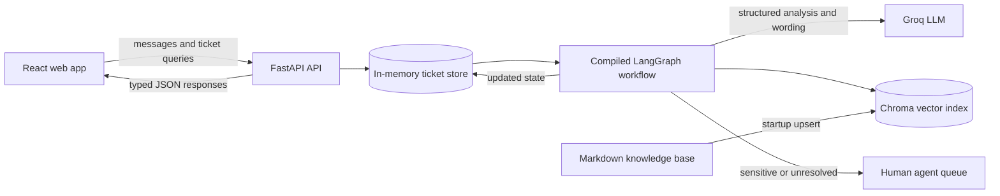
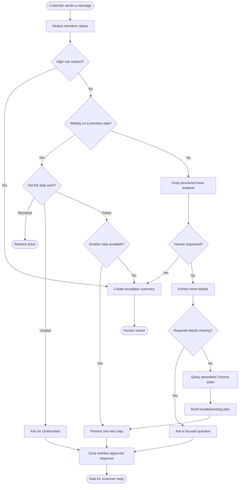

# QuickCart Support Resolution Agent

QuickCart is a demo support assistant for a fictional online store. A customer can describe a problem in everyday language, and the app opens or continues a ticket, gathers any missing details, finds relevant help content, and guides them through troubleshooting one step at a time. If the issue needs a person, the app prepares an escalation for review.

Behind the conversation, a compiled LangGraph workflow coordinates the work. Groq helps interpret messages and write clear replies, while a local Chroma index searches the Markdown help articles. The important support decisions—such as safety checks, required details, approved troubleshooting steps, retries, and escalation—are handled by application logic. If Groq or Chroma is unavailable, tested rule-based and keyword fallbacks let the app keep working with more limited language understanding.

This repository is intended as a local development MVP: it is useful for exploring a support workflow and its UI, but it does not connect to a real store or persist tickets across restarts.

## What it can do

The MVP handles three support areas:

- Account login and password-reset problems
- Failed payments and successful payments with a missing order
- Delayed or missing deliveries

For each conversation, the application keeps a ticket-level workflow state containing the detected intent, extracted details, missing fields, retrieved documents, attempted troubleshooting steps, and resolution status. A case is escalated when it is sensitive, explicitly requests a human, is outside the supported scope, or exhausts its available troubleshooting steps.

## Screens

- **Chat** is the customer conversation and a live inspector for workflow state.
- **Tickets** lists every ticket created during the current backend session.
- **Agents** shows cases that were escalated for human review.
- **Knowledge** displays the support documents available to the retriever.

## Technology

| Area | Current choice | Purpose |
| --- | --- | --- |
| Frontend | React, TypeScript, Vite | Customer chat and support operations UI |
| API | FastAPI, Pydantic | HTTP endpoints and request/response validation |
| Workflow | LangGraph `StateGraph` | Explicit nodes, state, and conditional routing |
| Language | Groq via `ChatGroq` | Structured issue analysis, resolution understanding, and response writing |
| Storage | In-memory ticket store | Simple local development baseline |
| Retrieval | Persistent Chroma | Vector search over the Markdown knowledge base |
| Tests | Pytest | Covers the core workflow paths |

## Architecture



The API stays small: `TicketStore` owns conversation state and invokes the compiled graph. Each graph node receives `SupportState` and returns only the fields it updates. The model helps interpret language and phrase replies; application logic remains responsible for safety, required information, approved troubleshooting actions, and escalation.

## Workflow



Troubleshooting is deliberately paced one action at a time. The customer tries a step and reports what happened before the app suggests another. That keeps instructions manageable and gives a human reviewer a record of the steps already attempted.

## Project structure

```text
customer-support-agent/
|-- backend/
|   |-- app/
|   |   |-- api/                 # FastAPI route handlers
|   |   |-- graph/
|   |   |   |-- nodes/           # Safety, intent, extraction, planning, resolution
|   |   |   |-- builder.py       # Workflow coordinator
|   |   |   |-- routes.py        # Branch decisions
|   |   |   `-- state.py         # Shared workflow state contract
|   |   |-- rag/
|   |   |   `-- retriever.py     # Local keyword-based retrieval
|   |   |-- schemas/             # Pydantic API and domain models
|   |   |-- security/
|   |   |   `-- redaction.py     # Sensitive-data masking
|   |   |-- services/
|   |   |   |-- llm_service.py   # Lazy Groq client and structured model calls
|   |   |   `-- ticket_service.py
|   |   |-- config.py
|   |   `-- main.py
|   |-- knowledge_base/           # Human-readable support procedures
|   |-- data/chroma/              # Generated persistent vector index
|   |-- tests/
|   |   `-- test_workflow.py
|   |-- Dockerfile
|   `-- requirements.txt
|-- frontend/
|   |-- src/
|   |   |-- components/          # Shared UI components
|   |   |-- pages/               # Chat, tickets, agents, knowledge
|   |   |-- services/            # API client
|   |   |-- types/               # TypeScript response contracts
|   |   |-- App.tsx
|   |   |-- main.tsx
|   |   `-- styles.css
|   |-- Dockerfile
|   |-- package.json
|   `-- vite.config.ts
|-- architecture.md              # Short architecture notes and roadmap
|-- docker-compose.yml
`-- README.md
```

Generated folders such as `node_modules`, `dist`, caches, and local virtual environments are intentionally omitted from the diagram.

## Run locally

You’ll need Python 3.11 or newer, Node.js 20 or newer, and (for model-powered language handling) a Groq API key. Docker is optional if you prefer the container setup below.

### 1. Start the backend

From the project root:

```powershell
cd backend
python -m venv .venv
.\.venv\Scripts\Activate.ps1
python -m pip install -r requirements.txt
python -m uvicorn app.main:app --reload
```

Copy the example environment file and add your Groq key:

```powershell
Copy-Item .env.example .env
notepad .env
```

Set these values in `.env`:

```dotenv
GROQ_API_KEY=gsk_your_real_key_here
GROQ_MODEL=llama-3.3-70b-versatile
GROQ_TIMEOUT_SECONDS=20
VECTOR_DB_PATH=./data/chroma
```

Create a key in the [Groq console](https://console.groq.com/keys). Do not add quotes around the key, and never commit `.env`. Without a valid key the backend still starts, but the Runtime panel will report `Rule fallback` instead of `Groq LLM`.

Start the API:

```powershell
python -m uvicorn app.main:app --reload
```

The API runs at `http://localhost:8000`. Interactive API documentation is at `http://localhost:8000/docs`, and the health check is at `http://localhost:8000/health`.

### 2. Start the frontend

Open a second terminal from the project root:

```powershell
cd frontend
npm install
npm run dev
```

Open `http://localhost:5173`. The frontend uses `http://localhost:8000` by default. To point it at another API, set `VITE_API_URL` before starting Vite.

## Run with Docker

```powershell
docker compose up --build
```

The frontend is available at `http://localhost:3000`, and the backend at `http://localhost:8000`. Compose reads `backend/.env` when present and keeps the Chroma index in a named Docker volume.

## Try a conversation

Enter a payment example in the empty query box:

```text
Paid through UPI yesterday, transaction TXN8892, but order is not showing.
```

Here’s what should happen:

1. LangGraph routes the message through safety and issue analysis.
2. Groq returns a validated intent and extracted entities using Pydantic schemas.
3. Chroma retrieves the payment reconciliation article from the Markdown knowledge base.
4. The deterministic planner selects one approved action, and Groq writes the customer-facing response.
5. A reply such as `Still not showing in my account` marks that attempt as failed and advances to the next step.
6. A reply such as `Yes, it is fixed now` resolves the ticket.

Other useful messages:

```text
I cannot sign in. My account email is customer@example.com.
Order 48291 was due yesterday but has not arrived.
I want to speak to a human agent.
```

## API summary

| Method | Endpoint | Description |
| --- | --- | --- |
| `GET` | `/health` | Service health check |
| `POST` | `/messages` | Create or continue a support conversation |
| `GET` | `/messages/{ticket_id}` | Return a ticket's message history |
| `POST` | `/tickets` | Create an empty ticket |
| `GET` | `/tickets` | List tickets in the current process |
| `GET` | `/tickets/{ticket_id}` | Return one ticket summary |
| `GET` | `/knowledge` | List retrieval documents |
| `GET` | `/agents/escalations` | List escalated cases |
| `POST` | `/agents/tickets/{ticket_id}/resolve` | Mark a ticket resolved |

Example request:

```powershell
$body = @{
  customer_id = "CUST-DEMO"
  message = "Order 48291 was due yesterday but has not arrived."
} | ConvertTo-Json

Invoke-RestMethod `
  -Method Post `
  -Uri http://localhost:8000/messages `
  -ContentType "application/json" `
  -Body $body
```

Send the returned `ticket.ticket_id` as `ticket_id` in the next request to continue the same conversation.

## Tests and build checks

Run backend tests from `backend`:

```powershell
python -m pytest
```

Build the frontend from `frontend`:

```powershell
npm run build
```

The tests do not call Groq; model behavior is mocked where needed. They cover the compiled graph, offline fallback, missing payment details, retrieval and planning, password-reset handling, and escalation for sensitive data.

To confirm integrations while the backend is running, open `http://localhost:8000/health`. A configured installation reports:

```json
{
  "orchestration": "langgraph",
  "groq_configured": true,
  "groq_model": "llama-3.3-70b-versatile",
  "vector_store": "chroma"
}
```

The chat's Runtime panel reports what actually handled each turn. `groq_configured` only confirms that a key was loaded; a failed model request is still visible as a fallback in the turn response.

## Current limitations

QuickCart is a learning and development MVP. Before using an approach like this for real customer support, the following gaps need attention:

- Tickets live in memory and disappear when the backend restarts.
- Groq requires network access and a valid API key; language tasks fall back to narrower rules when it is unavailable.
- Chroma currently uses a deterministic token-hash embedding suited to this small local corpus, not a production semantic embedding model.
- Only three knowledge documents and three support areas are included.
- Authentication, authorization, agent assignment, and real commerce tools are not implemented.
- The resolution checker understands a small set of confirmation phrases.
- The API process is not designed for multiple workers because each worker would have a separate ticket store.

Use fictional customer, order, and payment details while developing. Keep real secrets out of source control, and never commit a populated `.env` file.

## Roadmap

The most useful next step is ticket persistence: add SQLAlchemy models and SQLite behind the existing `TicketStore` boundary. From there, the project could add LangGraph checkpointing, production-grade embeddings, authenticated customer and agent roles, and permission-checked order and payment tools.

Keeping those upgrades behind the current node and service boundaries lets each part evolve without rewriting the user interface or API contract.

## Integration references

- [LangChain ChatGroq integration](https://docs.langchain.com/oss/python/integrations/chat/groq)
- [LangGraph Graph API](https://docs.langchain.com/oss/python/langgraph/graph-api)
- [Chroma persistent clients](https://docs.trychroma.com/docs/run-chroma/clients)
- [Groq production models](https://console.groq.com/docs/models)
